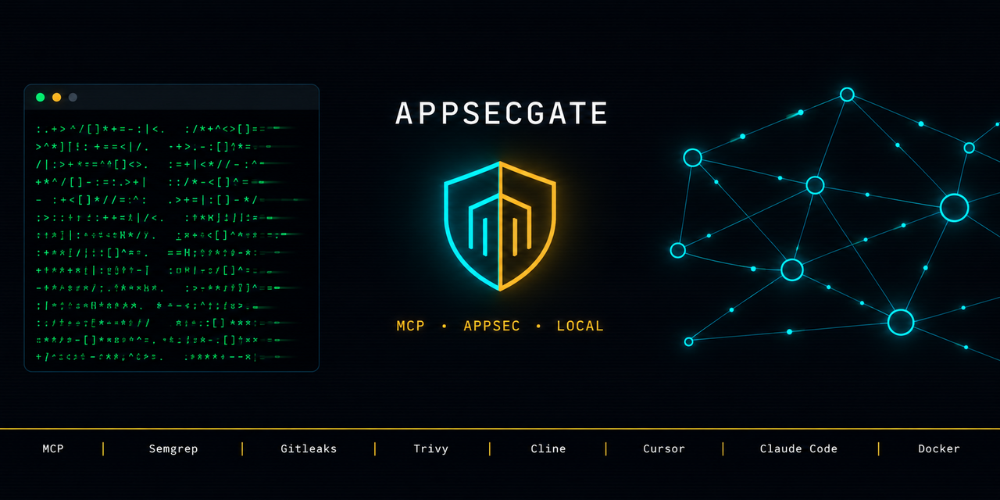

<p align="center">
  
</p>

# AppSecGate MCP

**Local-first security scanning for AI coding agents.**

AI agents ship code faster than security can review it. AppSecGate is an MCP
server that scans files, diffs, and whole projects **right inside Claude Code,
Cursor, Cline, or Continue** — offline, without sending your code anywhere.
Findings are normalized, deduplicated by fingerprint, tracked between scans, and
returned to the agent as fix contexts.

> Security should not be a drag. It should be invisible to the developer and
> transparent to security.

## When to use / When NOT to use

**Use it when:**

- You build with an AI agent and want every diff scanned before it lands.
- You want findings tracked across scans (deduplicated by fingerprint), not a pile of reports.
- You want to stay offline: no network calls, no code leaves your machine, and the server itself never calls an LLM.
- You want your agent to see the context needed to fix a finding (`get_fix_context`) and to verify the fix later (`verify_fix`).

**Do NOT use it when:**

- You need CI blocking — Phase 1 is warn-only locally; CI gating comes in Phase 2.
- You need centralized policy, team dashboards, or ASOC sync — that is the Master Server (Phase 2).
- You need large-scale GUI triage.

## Demo

<!-- Demo GIF (install + Juice Shop scan): docs/assets/demo.gif — to be recorded. -->

## Quick Install

The server runs as a Docker container. Your project is mounted **read-only**
(`:ro`), the container has **no network access** (`--network=none`), and scans
never write to your source tree.

```bash
docker pull moondoom/appsecgate-mcp:0.1.0
```

### Claude Code

Add to `<project>/.mcp.json`:

```json
{
  "mcpServers": {
    "appsecgate": {
      "command": "docker",
      "args": [
        "run", "--rm", "-i", "--network=none", "--read-only",
        "--tmpfs=/tmp:size=100M,mode=1777", "--cap-drop=ALL",
        "--security-opt=no-new-privileges:true",
        "-v", ".:/workspace:ro",
        "-v", "appsecgate-cache:/home/appsecgate/.cache",
        "-v", "appsecgate-data:/home/appsecgate/.appsecgate-mcp",
        "moondoom/appsecgate-mcp:0.1.0",
        "--transport", "stdio", "--project", "/workspace"
      ]
    }
  }
}
```

Or register it directly:

```bash
claude mcp add appsecgate -- docker run --rm -i --network=none --read-only \
  --tmpfs=/tmp:size=100M,mode=1777 --cap-drop=ALL \
  --security-opt=no-new-privileges:true \
  -v .:/workspace:ro \
  -v appsecgate-cache:/home/appsecgate/.cache \
  -v appsecgate-data:/home/appsecgate/.appsecgate-mcp \
  moondoom/appsecgate-mcp:0.1.0 --transport stdio --project /workspace
```

### Cursor

Add to `<project>/.cursor/mcp.json`:

```json
{
  "mcpServers": {
    "appsecgate": {
      "command": "docker",
      "args": [
        "run", "--rm", "-i", "--network=none", "--read-only",
        "--tmpfs=/tmp:size=100M,mode=1777", "--cap-drop=ALL",
        "--security-opt=no-new-privileges:true",
        "-v", ".:/workspace:ro",
        "-v", "appsecgate-cache:/home/appsecgate/.cache",
        "-v", "appsecgate-data:/home/appsecgate/.appsecgate-mcp",
        "moondoom/appsecgate-mcp:0.1.0",
        "--transport", "stdio", "--project", "/workspace"
      ]
    }
  }
}
```

### Cline

Cline (v4.x) reads MCP servers from the shared settings file
`~/.cline/data/settings/cline_mcp_settings.json`. Add the `appsecgate` server:

```json
{
  "mcpServers": {
    "appsecgate": {
      "type": "stdio",
      "command": "docker",
      "args": [
        "run", "--rm", "-i", "--network=none", "--read-only",
        "--tmpfs=/tmp:size=100M,mode=1777", "--cap-drop=ALL",
        "--security-opt=no-new-privileges:true",
        "-v", "/absolute/path/to/your/project:/workspace:ro",
        "-v", "appsecgate-cache:/home/appsecgate/.cache",
        "-v", "appsecgate-data:/home/appsecgate/.appsecgate-mcp",
        "moondoom/appsecgate-mcp:0.1.0",
        "--transport", "stdio", "--project", "/workspace"
      ],
      "cwd": "/absolute/path/to/your/project",
      "env": {},
      "disabled": false,
      "timeout": 600
    }
  }
}
```

For a shared (user-level) config use an **absolute** project path in `-v` and
`cwd`; a relative `.:/workspace:ro` works only in a per-project `.mcp.json`.
### Continue

Add to `<project>/.continue/mcpServers/appsecgate.yaml`:

```yaml
name: appsecgate
version: 0.1.0
schema: v1
mcpServers:
  - name: appsecgate
    type: stdio
    command: docker
    args:
      - run
      - --rm
      - -i
      - --network=none
      - --read-only
      - --tmpfs=/tmp:size=100M,mode=1777
      - --cap-drop=ALL
      - --security-opt=no-new-privileges:true
      - -v
      - .:/workspace:ro
      - -v
      - appsecgate-cache:/home/appsecgate/.cache
      - -v
      - appsecgate-data:/home/appsecgate/.appsecgate-mcp
      - moondoom/appsecgate-mcp:0.1.0
      - --transport
      - stdio
      - --project
      - /workspace
    connectionTimeout: 600000
    requestOptions:
      timeout: 600000
```

**Verify the install:** restart the client, then run `scan_file` on any file; tools
appear with the `mcp__appsecgate__` prefix. Full instructions, edge cases, and
diagnostics: [docs/deploy-agents.md](docs/deploy-agents.md).

## MCP tools (14)

| Tool | What it does |
|------|--------------|
| `scan_file` | Scan a single file and return normalized findings. |
| `scan_diff` | Scan staged + unstaged + untracked changes in the current git repository. |
| `scan_project` | Scan the entire project or a specific directory inside it. |
| `get_fix_context` | Return the ContextPack for a finding (finding + code window + rule doc). |
| `get_fix_context_batch` | Return ContextPacks for multiple findings (limit 20). |
| `verify_fix` | Verify a single finding: rescan the file and match by (logical_id). |
| `verify_fix_batch` | Verify up to 20 findings; each file is rescanned once. |
| `query_findings_db` | Read-only SELECT on public views (v_findings, v_summary, v_projects). |
| `export_snapshot` | Export a snapshot of findings in ndjson format (parquet — Phase 2). |
| `get_config` | Return the active (merged) session configuration. |
| `update_config` | Deep-merge updates into .appsecgate-mcp/config.yaml and reload the session. |
| `submit_feedback` | Submit feedback on a finding (FALSE_POSITIVE / CONFIRMED / WONT_FIX). |
| `get_scan_history` | Return the shown findings log (shown_findings.db) with verification attempts. |
| `suppress_finding` | Create a local suppression (does not affect CI gate in Phase 1). |

## Scanners (Phase 1)

| Category | Scanners | Notes |
|----------|----------|-------|
| SAST | Semgrep | Bundled offline rules (Rules Bundle) — no registry access needed |
| Secrets | Gitleaks, TruffleHog | Values redacted before they are stored |
| SCA | Trivy | Vulnerability DB seeded at image build time |

Every scanner runs as a separate subprocess (no shell). Planned for later phases:
Bandit, ESLint (SAST); OSV-Scanner, Dependency-Track (SCA); Checkov, KICS (IaC);
OWASP ZAP (DAST).

## Security model

- **Read-only project.** The project is mounted `:ro`; the server never writes to source files.
- **Offline by default.** `network_mode: none` — no outbound network calls, ever.
- **No LLM calls.** The fix is generated by your agent's own model; the server only ships context data, never prompts.
- **Secrets redacted before storage.** At write time, not at read time.
- **Hardened container.** Non-root UID 1000, read-only rootfs, `cap-drop=ALL`, `no-new-privileges`.

## Configuration

Per-project settings live in `.appsecgate-mcp/config.yaml` and are deep-merged over
the image defaults (`/etc/appsecgate/default.yaml`):

```yaml
version: 1
stack:
  languages: [python, typescript]
  frameworks: [fastapi, react]

scanners:
  sast:
    enabled: true
    tool: semgrep
    rulesets: []          # semgrep rules come from the local Rules Bundle
  secrets:
    enabled: true
    tool: gitleaks
  sca:
    enabled: true
    tool: trivy
    severity_threshold: HIGH

gates:
  block_on: [CRITICAL, HIGH]
  warn_on: [MEDIUM]
```

## Build from source

```bash
make setup          # create the uv environment
make check          # lint (ruff) + tests (pytest)
make docker-build   # build moondoom/appsecgate-mcp:0.1.0
```

## Documentation

- [Agent deployment guide](docs/deploy-agents.md) — all four clients, verification steps, troubleshooting
- [Architecture](docs/architecture.md)
- [Phase 1 design spec](docs/fix-workflow-design.md)
- [E2E report](docs/reports/e2e-report-2026-10-14.md)
- [Product vision](docs/product-vision.md)
- [Open tasks](docs/open-tasks.md)

## License

MIT — see [LICENSE](LICENSE). Bundled scanner rules are third-party (see
[third-party notices](mcp-server/rules/THIRD_PARTY_NOTICES.md)).

Русскоязычная версия: [README.ru.md](README.ru.md).
Restart Cline after the change.